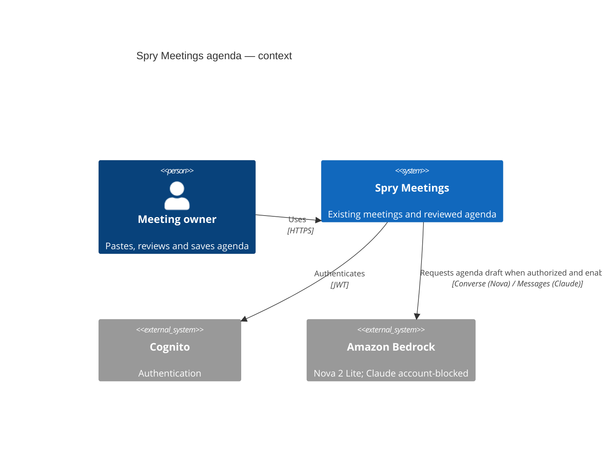
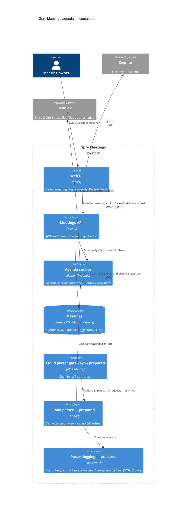

# C4 — reviewed agenda attached to existing meetings

Implemented local path: Web → FastAPI ownership check → agenda service/mock or explicitly enabled Nova → draft.
User reviews a separate copy, then Save → FastAPI → existing meeting JSONB pair.
Read-back displays final agenda and original suggestion; Parse has no database write.
The prepared gateway/Lambda path is not deployed or wired into the frontend. JWT on
that path authenticates a user but cannot by itself establish meeting ownership; future
cloud wiring must preserve the owner check through FastAPI or an equivalent boundary.
No diagram is evidence of a deployed resource or successful Claude invocation.

Manual fallback: user fills agenda without a model result; explicit Save stores agenda with ai_suggestion=null. Parse failures never save. Parse telemetry uses agenda-v1 and distinguishes mock from Bedrock.

User-supplied local Docker evidence confirms Nova Converse agenda-v1 parse followed by
human Edit/Save. This is separate from the prepared cloud Lambda/CloudWatch path.
See evidence/nova-local-agenda-success.json; Claude account access remains blocked.
